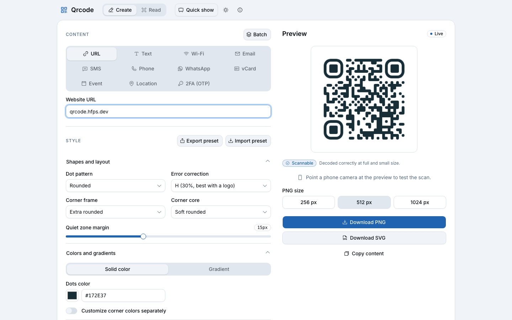
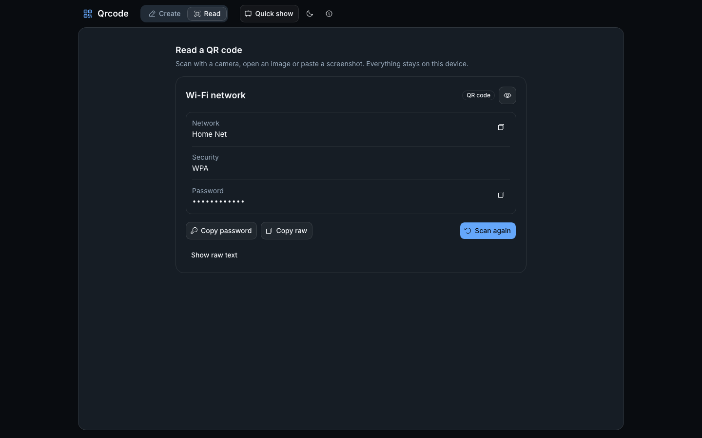
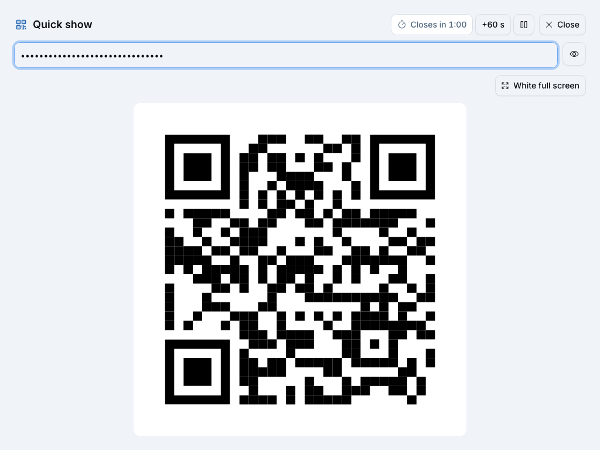
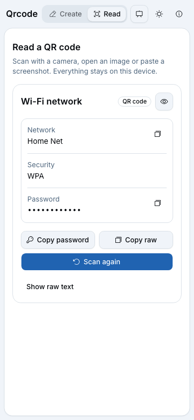
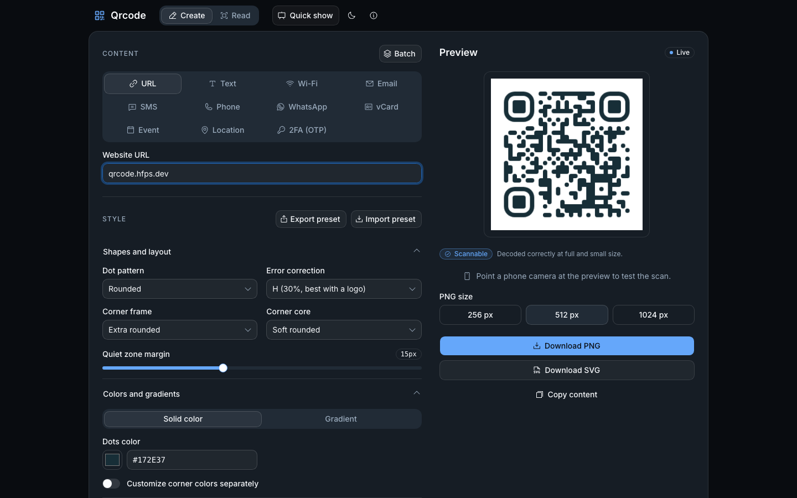

# Qrcode

Create and read QR codes in the browser. Free, open source, no account, and nothing leaves your device.
Live at <https://qrcode.hfps.dev> (formerly QRGo).



## Features

- **Create**: URL, text, Wi-Fi, email, SMS, phone, WhatsApp, vCard, calendar event, location and 2FA (otpauth) codes. Dot, corner, color, gradient and logo styling, with style presets (JSON export and import). A live scannability check decodes the styled code and flags low contrast, big logos and a thin quiet zone. Download PNG (256, 512 or 1024 px) or SVG, or batch-create up to 1,000 codes from pasted rows or a CSV into a ZIP.
- **Read**: scan with a camera (device picker, mirror, torch), share a window or screen (desktop), open an image, drop one on the page or paste a screenshot. Wi-Fi, vCard/MeCard, `mailto:`, SMS, `tel:`, `geo:`, `otpauth://` and links are parsed, with an action for each (save contact, call, open in maps, compose email or SMS, copy password); 2FA codes show the current one-time code. Passwords and OTP secrets are masked until you reveal them, and a copied secret is cleared from the clipboard after 30 seconds. Links are never opened automatically.
- **Quick show**: press `Q` (or use the header button), paste a password or link and get a huge black-on-white code that a phone camera reads from across a desk. Masked input, the screen stays on, and it closes itself after 60 seconds (add time or pause); `Esc` closes it at once. Either way the text is cleared. Built for moving a secret between a computer and a phone that share no network.
- **Installable and offline**: a PWA. Share a screenshot to it or open an image with it to read the code; shortcuts for Read and Quick show. On browsers without `BarcodeDetector` the scanner fallback is downloaded in the background, so reading also works offline.
- Light, dark and system themes with five palettes (default: blue).

| Read a Wi-Fi code | Quick show |
| :--- | :--- |
|  |  |

<p> </p>

## Privacy

Codes are drawn and decoded in your browser. What you type, scan, paste or upload is never sent to a server and never stored: there is no history. No account, no analytics, no cookies. The only thing saved in the browser is your theme and palette choice (`localStorage`: `qrcode.theme`, `qrcode.palette`). The clipboard is written only when you press Copy, and a copied secret (password, 2FA secret or code) is overwritten with an empty string after 30 seconds.

## Stack

Vite, React 19, TypeScript (strict), Tailwind CSS v4, shadcn/ui (`radix-vega`), Inter, Phosphor icons, [`qr-code-styling`](https://github.com/kozakdenys/qr-code-styling), [`barcode-detector`](https://github.com/Sec-ant/barcode-detector) with [`zxing-wasm`](https://github.com/Sec-ant/zxing-wasm), `vite-plugin-pwa`, Vitest. Hosted as a Cloudflare Worker with static assets. Package manager: [bun](https://bun.sh). See [docs/architecture.md](docs/architecture.md) and [docs/adr](docs/adr/README.md).

## Scripts

```sh
bun install
bun run dev         # dev server
bun run build       # production build (assets + worker in .cloudflare/output)
bun run lint        # eslint
bunx tsc -b         # type check
bun run test        # vitest
bun run e2e         # build + Playwright (Chromium) against the production build with the real _headers
bun run deploy:dry  # build + cf deploy --dry-run (needs Node >= 22.18)
```

Deploying (the `cf` CLI, the `qrgo.hfps.dev` redirect and its manual DNS step) is described in [docs/deploy.md](docs/deploy.md). Icons are rebuilt from `scripts/glyph.svg` with `scripts/build-icons.mjs` and `scripts/build-maskable.mjs`.

## License

Copyright (C) Henrique Silva. Qrcode is free software under the **GNU Affero General Public License, version 3 or later** (AGPL-3.0-or-later). See [LICENSE](LICENSE). It comes without warranty; test your codes before you print them.

### Third-party notices

| Component | License |
| :--- | :--- |
| [React](https://github.com/facebook/react), [Radix UI](https://github.com/radix-ui/primitives), [shadcn/ui](https://ui.shadcn.com/), [Tailwind CSS](https://tailwindcss.com/), [Sonner](https://github.com/emilkowalski/sonner), [Vite](https://vite.dev/), [vite-plugin-pwa](https://github.com/vite-pwa/vite-plugin-pwa) | MIT |
| [qr-code-styling](https://github.com/kozakdenys/qr-code-styling) | MIT |
| [barcode-detector](https://github.com/Sec-ant/barcode-detector) | MIT |
| [zxing-wasm](https://github.com/Sec-ant/zxing-wasm) | MIT |
| [ZXing-C++](https://github.com/zxing-cpp/zxing-cpp), compiled into the zxing-wasm binary | Apache-2.0 |
| [Phosphor Icons](https://github.com/phosphor-icons/homepage) | MIT |
| [Inter](https://rsms.me/inter/) (via `@fontsource-variable/inter`) | SIL Open Font License 1.1 |

The same list is shown in the app's About dialog.
